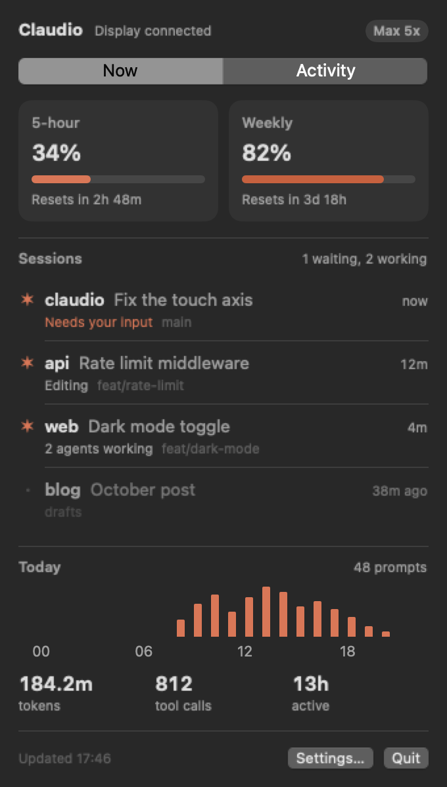
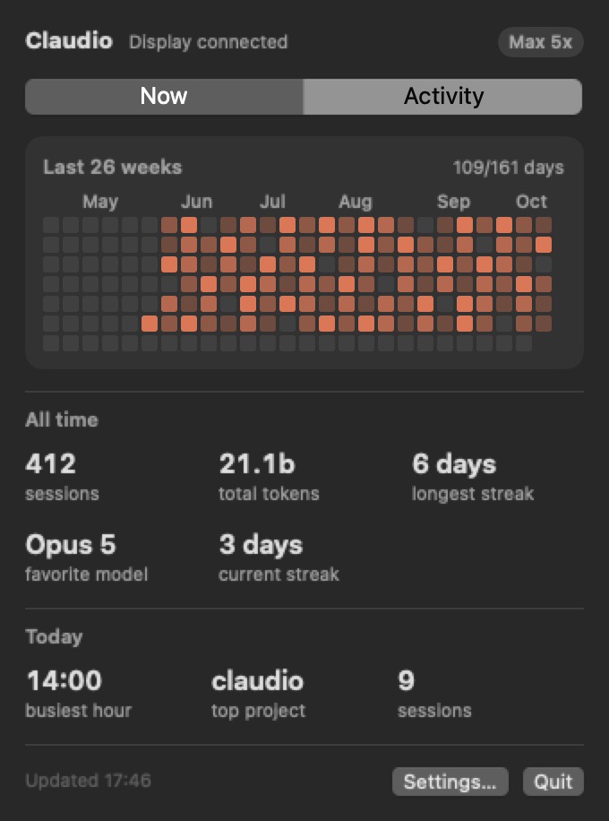

<div align="center">
  
  <h1>Claudio</h1>
  <p>A desk display for <strong>Claude Code</strong>: usage limits, every open session and what it's doing, today's activity and six months of history, on a small AMOLED next to the keyboard.</p>
  <p><sub>Claudio is a common Brazilian name, and a joke on Claude.</sub></p>

  [](https://github.com/eduardoborges/claudio/releases/latest)
  [](https://github.com/eduardoborges/claudio/commits/main)
  [](#what-you-need)
</div>

---

**[Quick start](#quick-start)** · **[What it shows](#what-it-shows)** · **[Settings](#settings)** · **[Linux and Windows](#linux-and-windows)** · **[How it works](#how-it-works)** · **[Development](#development)**

| Sessions | Usage | Today | Stats |
| :-: | :-: | :-: | :-: |
|  |  |  |  |

## What you need

- **The display.** A [Waveshare ESP32-S3-Touch-AMOLED-2.16](https://www.waveshare.com/esp32-s3-touch-amoled-2.16.htm), the board I build and test on. [Six more Waveshare boards](#other-boards) build too, but I haven't checked the current screens on them.
- **A computer to feed it.** The Mac app needs macOS 14 or later on Apple silicon. Linux and Windows run a small daemon instead.
- **Claude Code**, logged in to a paid plan.

## Quick start

On a Mac:

```sh
brew install --cask eduardoborges/tap/claudio
```

Open Claudio. A welcome guide walks you through the rest:

1. **Flash** the display over USB with the latest firmware release. Flashing keeps the pairing and the display's settings.
2. **Pair** it once in System Settings → Bluetooth (Connect next to "Claudio"), and allow Bluetooth when macOS asks.
3. **Install the hooks** that feed sessions and alerts. Claudio adds its own to `~/.claude/settings.json`, leaves yours alone and backs up the file first.
4. **Turn on Open at login.**

Claudio reads the token from the Keychain entry Claude Code already keeps. It lives in the menu bar: click Clawd for usage, sessions and today's activity, or open Settings for everything else, including the welcome guide again.

 

The app logs to `~/Library/Logs/Claudio.log`.

## What it shows

The display starts on Sessions. Swipe sideways or tap the left button to move between the four workspaces, and tap the screen to flip to the splash and back.

**Sessions.** One row per open Claude Code session: the project folder and title (Claude Code's, or yours after `/rename`), how long it has been working or how long ago it finished, the git branch, and what it's doing: `Editing`, `Running`, `Searching`, `2 agents working`, or `Needs your input` in orange. Sessions that need you go on top, then the working ones, then the finished ones. A working row stays put until you send that session a new prompt, so the list doesn't reshuffle every time a tool runs. When the rows don't fit, each drops to one line and the last reads `+3 more`. Two thin bars above the list keep the 5-hour and weekly usage in view.

**Usage.** The 5-hour and weekly limits, each with the time left until it resets, and a pill with your plan. Enterprise accounts see their spend against the billing period.

**Today.** Messages per hour since midnight, with prompts, tool calls, tokens, sessions, the busiest project and active hours. It counts the main conversation in the transcripts under `~/.claude/projects` and refreshes at most once a minute.

**Stats.** A 26-week heatmap and six numbers under it: sessions, total tokens, active days, the longest and current streak, and your favorite model. It reads `~/.claude/stats-cache.json`, the file behind `/stats`, so it's as fresh as Claude Code last left it.

### Clawd


When Claude Code asks a question or wants a permission, Clawd walks onto the screen, waves, points, and the message scrolls along the bottom. He leaves when you tap the screen, when the session moves on, or after two minutes. When a task that ran for five minutes or more finishes, he comes back to dance.

While sessions work, the small Clawd in the corner acts out the newest one: he types on a laptop during edits and shell commands, holds a magnifier while Claude reads or searches, and rides a cloud while it thinks. The splash plays Anthropic's official Clawd animations, which get busier as your usage climbs.

<br clear="right">

### Buttons

| Button | What it does |
| --- | --- |
| Left (BOOT) | Tap for the next workspace. Hold to send Space, Claude Code's push to talk |
| Middle (PWR) | On the splash, the next animation. Hold 3 seconds and let go for pairing mode |
| Right | Shift+Tab, Claude Code's mode toggle |

The keys go out as a Bluetooth keyboard, so they land in whatever window has focus. Not every board has all three buttons. To pair again, hold the power button for 3 seconds and let go: the display forgets its bond and starts advertising.

## Settings

On a Mac, Claudio's Settings window edits all of these. Elsewhere, edit `~/.config/claude-usage-monitor/config`; the daemon rereads it on every poll, and [`daemon/config.example`](daemon/config.example) documents each key.

| Key | Default | What it does |
| --- | --- | --- |
| `beep` | `off` | Beep on alerts and celebrations |
| `chime` | `off` | Chime when the 5-hour limit resets |
| `done_after` | `5` | Minutes a task has to run to earn a celebration. `0` turns it off |
| `clock` | `off` | Show the time in place of the workspace title: `auto`, `12` or `24` |
| `config_dirs` | `~/.claude` | Several Claude config folders, comma separated. The display shows the one in use |
| `poll_interval` | `60` | Seconds between usage checks. Linux only, the Mac app polls every minute |
| `heartbeat_interval` | `60` | Seconds between replays of the last reading. Linux only |
| `menubar_usage` | `on` | Show the 5-hour usage next to the menu bar icon. Mac app only |
| `board` | `waveshare_amoled_216` | The board the Mac app's Firmware settings flash. Mac app only |

The chime and the beep play on boards with a speaker: the S3 AMOLED-2.16 and 1.8, and the LCD-1.54.

## Linux and Windows

On Linux, a bash daemon does the Mac app's job. Flashing goes through the [PlatformIO CLI](https://docs.platformio.org/en/latest/core/installation/index.html):

```sh
./flash.sh waveshare_amoled_216      # defaults to /dev/ttyACM0
bluetoothctl scan le                 # wait for "Claudio"
bluetoothctl pair <MAC> && bluetoothctl trust <MAC>
./install.sh
systemctl --user start claude-usage-daemon
```

The daemon needs BlueZ (`bluetoothctl`, `busctl`, `dbus-monitor`), `curl`, `setsid`, `stdbuf` and a systemd user session. Logs: `journalctl --user -u claude-usage-daemon -f`. Then [set up the hooks by hand](#hooks-by-hand).

The Windows daemon shows usage only. Sessions, Today, Stats, alerts and celebrations need the Mac app or the Linux daemon. Setup is in [`daemon/README-windows.md`](daemon/README-windows.md).

### Hooks by hand

<details>
<summary>The hooks the Mac app installs for you, for Linux and Windows</summary>

Merge these into `~/.claude/settings.json` and point the path at your checkout. The script needs `jq` (`brew install jq` or `sudo apt install jq`). Claude Code picks up hook changes without a restart.

```json
{
  "hooks": {
    "Notification": [
      { "matcher": "permission_prompt|elicitation_dialog",
        "hooks": [{ "type": "command", "command": "/path/to/claudio/daemon/attention-hook.sh alert" }] }
    ],
    "PreToolUse": [
      { "matcher": "AskUserQuestion",
        "hooks": [{ "type": "command", "command": "/path/to/claudio/daemon/attention-hook.sh alert" }] },
      { "matcher": "*",
        "hooks": [{ "type": "command", "command": "/path/to/claudio/daemon/attention-hook.sh tool" }] }
    ],
    "UserPromptSubmit": [
      { "hooks": [{ "type": "command", "command": "/path/to/claudio/daemon/attention-hook.sh clear" }] }
    ],
    "PostToolUse": [
      { "matcher": "*",
        "hooks": [{ "type": "command", "command": "/path/to/claudio/daemon/attention-hook.sh clear" }] }
    ],
    "Stop": [
      { "hooks": [{ "type": "command", "command": "/path/to/claudio/daemon/attention-hook.sh stop" }] }
    ],
    "SubagentStop": [
      { "hooks": [{ "type": "command", "command": "/path/to/claudio/daemon/attention-hook.sh subagent" }] }
    ],
    "SessionEnd": [
      { "hooks": [{ "type": "command", "command": "/path/to/claudio/daemon/attention-hook.sh end" }] }
    ]
  }
}
```

| Hook | What it feeds |
| --- | --- |
| `Notification`, `PreToolUse` on `AskUserQuestion` | The alert when a session needs you |
| `PreToolUse` on `*` | The corner Clawd and the row's `Editing`, `Running`... |
| `UserPromptSubmit`, `PostToolUse` | Ending the alert once you answer |
| `Stop` | Marking a session done, and the celebration after a long task |
| `SubagentStop` | The `2 agents working` count. Without it, a finished agent keeps counting for up to 10 minutes |
| `SessionEnd` | Taking closed sessions off the list. Without it, they stay for up to six hours |

</details>

### The Python daemon on a Mac

<details>
<summary>The daemon from before the app</summary>

It still works and runs from a LaunchAgent. Don't run it next to the app: both would write to the display.

```sh
./flash-mac.sh waveshare_amoled_216   # finds /dev/cu.usbmodem* on its own
./install-mac.sh                      # venv with bleak and httpx, a LaunchAgent, a few questions
tail -F ~/Library/Logs/claude-usage-daemon.out.log
launchctl unload -w ~/Library/LaunchAgents/com.user.claude-usage-daemon.plist   # stop for good
```

</details>

## Other boards

The firmware also builds for these boards, but I haven't checked the current screens on them:

| Board | Env |
| --- | --- |
| Waveshare ESP32-C6-Touch-AMOLED-2.16 | `waveshare_amoled_216_c6` |
| Waveshare ESP32-S3-Touch-AMOLED-1.8 | `waveshare_amoled_18` |
| Waveshare ESP32-C6-Touch-AMOLED-1.8 | `waveshare_amoled_18_c6` |
| Waveshare ESP32-S3-Touch-AMOLED-2.06 | `waveshare_amoled_206` |
| Waveshare ESP32-S3-Touch-LCD-1.54 | `waveshare_lcd_154` |
| Waveshare ESP32-S3-Touch-LCD-4 | `waveshare_lcd_4` |

Each board is a folder under `firmware/src/boards/` plus a PlatformIO env, and [`docs/porting/adding-a-board.md`](docs/porting/adding-a-board.md) walks through adding one.

## How it works

1. The app or the daemon reads your Claude Code OAuth token, from the macOS Keychain or from `~/.claude/.credentials.json`.
2. Once a minute it sends a one-token request to Haiku and reads the limits from the response headers (`anthropic-ratelimit-unified-5h-utilization` and friends).
3. The hook script keeps one small JSON file per session, and the app turns those files into the Sessions list. Today and Stats come from the transcripts and from `stats-cache.json`.
4. Everything reaches the display as JSON written to a BLE characteristic, and LVGL draws it. [`docs/protocol.md`](docs/protocol.md) has the wire format.

## Development

The Mac app is a SwiftPM package in `mac/`:

```sh
mac/build.sh                    # builds and signs mac/build/Claudio.app; --dmg also packages it
swift test --package-path mac
```

`Claudio --render out.png` draws the panel with made-up data, `--welcome` opens the welcome guide on its own, and `--dump ss` prints a message the way the app builds it.

The simulator runs the whole firmware in an SDL window and plays daemon messages from `firmware/sim/scenario.jsonl`, so most UI work happens without the board:

```sh
pio run -d firmware -e sim && (cd firmware && .pio/build/sim/program)
```

[`SIM-USAGE.md`](SIM-USAGE.md) has the controls and headless screenshots. On a real board, `./screenshot.sh out.png` dumps the framebuffer over USB. The daemon tests run with `python -m pytest daemon/tests -q`.

Colors, type and shapes follow Anthropic's design system, mapped in [`docs/design-system.md`](docs/design-system.md). [`docs/fonts.md`](docs/fonts.md) covers the fonts and the patching LVGL 9 needs, and [`tools/README.md`](tools/README.md) covers converting the Clawd sprites and the Lucide icons.

Releases come from release-please: conventional commits on `main` build a release PR, and merging it publishes the signed and notarized dmg plus one firmware zip per board.

## Credits

This started as a fork of [HermannBjorgvin/Clawdmeter](https://github.com/HermannBjorgvin/Clawdmeter), went by the same name, and split off before its v2. Upstream rewrote the host side as a Rust app. This one has a native Mac app, keeps the small daemons for Linux and Windows, and puts the work into what the display shows. The two projects no longer share code or releases.

- [Hermann Björgvin](https://github.com/HermannBjorgvin) wrote the original Clawdmeter, and [Chris Davidson](https://github.com/lorddavidson) ported its host side to macOS.
- The Clawd animations are Anthropic's official mascot art, archived with notes in [`research/clawd-official/`](research/clawd-official/).
- Icons from [Lucide](https://lucide.dev) (MIT).

## License

None, on purpose. The repo ships Anthropic Sans and the Clawd art, both Anthropic's and used here without permission, so an open license on the whole thing would be a lie. Without a license, the code stays all rights reserved by its authors. Keep that in mind before you copy it.
