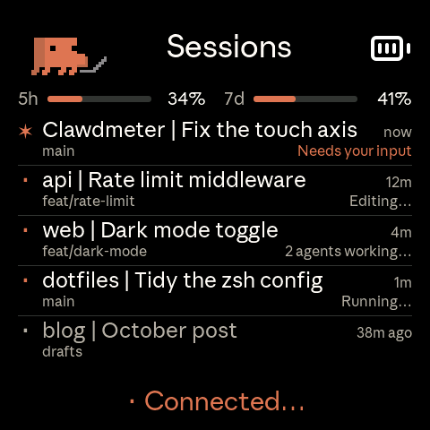
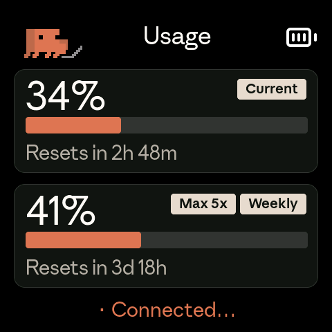
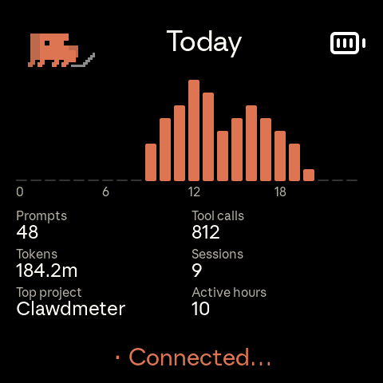
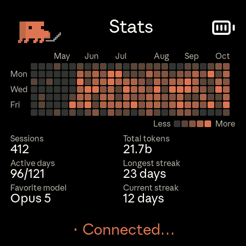
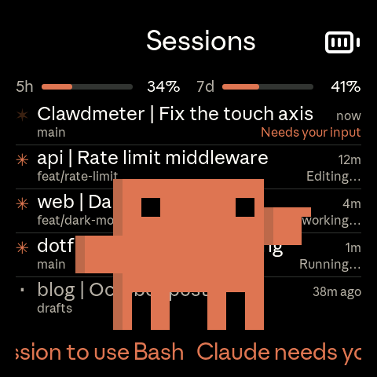

<div align="center">
  
  <h1>Tally</h1>
  <p>A desk display for <strong>Claude Code</strong>. Usage limits, every open session and what it's doing, today's activity and six months of history, on a small AMOLED next to the keyboard.</p>

  [](https://github.com/eduardoborges/tally/commits/main)
  [](#hardware)
</div>

---

**[Screens](#screens)** · **[Install](#install)** · **[Hooks](#claude-code-hooks)** · **[Settings](#settings)** · **[Protocol](#ble-protocol)**

> This started as a fork of [HermannBjorgvin/Clawdmeter](https://github.com/HermannBjorgvin/Clawdmeter), went by the same name, and split off before its v2. Upstream rewrote the host side as a Rust app. This one keeps the small daemons and puts the work into what the device shows. The two projects no longer share code or releases.

| Sessions | Usage | Today | Stats |
| :-: | :-: | :-: | :-: |
|  |  |  |  |

## Screens

The device starts on Sessions. Swipe sideways or tap the left button to move between the four workspaces, and tap the screen to flip to the splash and back.

### Sessions

One row per open Claude Code session. The first line has the project folder and the session's title (the one Claude Code generates, or yours after `/rename`), plus how long it has been working or how long ago it finished. The second line has the git branch and what the session is doing: `Editing`, `Running`, `Searching`, `2 agents working`, or `Needs your input` in orange.

Sessions that need you go on top, then the ones working, then the finished ones. A working row stays where it is until you send that session a new prompt, so the list doesn't reshuffle every time a tool runs. If there are more sessions than the screen fits, every row drops to one line and the last one reads `+3 more`. Two thin bars above the list keep the 5-hour and weekly usage in view.

The list needs the [hooks](#claude-code-hooks).

### Usage

The 5-hour session and the weekly limit, each with the time left until it resets, and a pill with your plan. Enterprise accounts get their spend against the billing period instead.

### Today

Messages per hour since midnight, with prompts, tool calls, tokens, sessions, the busiest project and the number of active hours. The daemon reads the transcripts in `~/.claude/projects`, counts the main conversation only and refreshes at most once a minute.

### Stats

A heatmap of the last 26 weeks and six numbers under it: sessions, total tokens, active days, the longest and current streak, and your favorite model. It comes from `~/.claude/stats-cache.json`, the file behind `/stats`, so it's as fresh as Claude Code last left it.

### When a session needs you



When Claude Code asks a question or wants a permission, Clawd walks onto the screen, waves, points, and the message scrolls along the bottom. He leaves when you tap the screen, when the session moves on, or after two minutes. When a task that ran for at least five minutes finishes, he comes back to dance.

While sessions work, the small Clawd in the corner acts out the newest one: he types on a laptop during edits and shell commands, holds a magnifier while Claude reads or searches, and rides a cloud while it thinks.

The splash plays Anthropic's official Clawd animations. They get busier as your usage climbs.

<br clear="right">

## Hardware

I built it on the [Waveshare ESP32-S3-Touch-AMOLED-2.16](https://www.waveshare.com/esp32-s3-touch-amoled-2.16.htm), a 480×480 AMOLED with touch, a battery connector and three side buttons. It's the only board I test on.

The firmware also builds for these boards, but I haven't checked the current screens on them:

| Board | Env |
| --- | --- |
| Waveshare ESP32-C6-Touch-AMOLED-2.16 | `waveshare_amoled_216_c6` |
| Waveshare ESP32-S3-Touch-AMOLED-1.8 | `waveshare_amoled_18` |
| Waveshare ESP32-C6-Touch-AMOLED-1.8 | `waveshare_amoled_18_c6` |
| Waveshare ESP32-S3-Touch-AMOLED-2.06 | `waveshare_amoled_206` |
| Waveshare ESP32-S3-Touch-LCD-1.54 | `waveshare_lcd_154` |
| Waveshare ESP32-S3-Touch-LCD-4 | `waveshare_lcd_4` |

Each board is a folder under `firmware/src/boards/` plus a PlatformIO env. [`docs/porting/adding-a-board.md`](docs/porting/adding-a-board.md) walks through adding one.

## Install

You need the [PlatformIO CLI](https://docs.platformio.org/en/latest/core/installation/index.html), `python3` and Claude Code logged in to a paid plan.

### macOS

```sh
./flash-mac.sh waveshare_amoled_216   # finds /dev/cu.usbmodem* on its own
./install-mac.sh
```

Then open System Settings → Bluetooth and click Connect next to "Tally". The daemon only talks to the device this Mac is connected to, and picks it up within a minute.

`install-mac.sh` creates a venv with `bleak` and `httpx`, asks about the clock, the chime and the alert beep, and loads a LaunchAgent. macOS asks for Bluetooth permission on the first run. The token comes from the Keychain entry Claude Code already keeps.

```sh
tail -F ~/Library/Logs/claude-usage-daemon.out.log                           # logs
launchctl unload ~/Library/LaunchAgents/com.user.claude-usage-daemon.plist   # stop
launchctl load -w ~/Library/LaunchAgents/com.user.claude-usage-daemon.plist  # start
```

### Linux

```sh
./flash.sh waveshare_amoled_216      # defaults to /dev/ttyACM0
bluetoothctl scan le                 # wait for "Tally"
bluetoothctl pair <MAC> && bluetoothctl trust <MAC>
./install.sh
systemctl --user start claude-usage-daemon
```

The Linux daemon is a bash script. It needs BlueZ (`bluetoothctl`, `busctl`, `dbus-monitor`), `curl`, `setsid`, `stdbuf` and a systemd user session. Logs: `journalctl --user -u claude-usage-daemon -f`.

### Windows

The Windows daemon only shows usage. Sessions, Today, Stats, alerts and celebrations need the macOS or Linux daemon. Setup is in [`daemon/README-windows.md`](daemon/README-windows.md).

### Pairing again

Hold the power button for 3 seconds and let go. The device forgets its bond and starts advertising again.

## Claude Code hooks

Sessions, alerts, the corner Clawd and the celebrations all come from Claude Code hooks. Merge these into `~/.claude/settings.json` and point the path at your checkout. The script needs `jq` (recent macOS ships it; otherwise `brew install jq` or `sudo apt install jq`).

```json
{
  "hooks": {
    "Notification": [
      { "matcher": "permission_prompt|elicitation_dialog",
        "hooks": [{ "type": "command", "command": "/path/to/tally/daemon/attention-hook.sh alert" }] }
    ],
    "PreToolUse": [
      { "matcher": "AskUserQuestion",
        "hooks": [{ "type": "command", "command": "/path/to/tally/daemon/attention-hook.sh alert" }] },
      { "matcher": "*",
        "hooks": [{ "type": "command", "command": "/path/to/tally/daemon/attention-hook.sh tool" }] }
    ],
    "UserPromptSubmit": [
      { "hooks": [{ "type": "command", "command": "/path/to/tally/daemon/attention-hook.sh clear" }] }
    ],
    "PostToolUse": [
      { "matcher": "*",
        "hooks": [{ "type": "command", "command": "/path/to/tally/daemon/attention-hook.sh clear" }] }
    ],
    "Stop": [
      { "hooks": [{ "type": "command", "command": "/path/to/tally/daemon/attention-hook.sh stop" }] }
    ],
    "SubagentStop": [
      { "hooks": [{ "type": "command", "command": "/path/to/tally/daemon/attention-hook.sh subagent" }] }
    ],
    "SessionEnd": [
      { "hooks": [{ "type": "command", "command": "/path/to/tally/daemon/attention-hook.sh end" }] }
    ]
  }
}
```

| Hook | What it feeds |
| --- | --- |
| `Notification`, `PreToolUse` on `AskUserQuestion` | The alert when a session needs you |
| `PreToolUse` on `*` | The corner Clawd and the row's `Editing`, `Running`... |
| `UserPromptSubmit`, `PostToolUse` | Ending the alert once you answer |
| `Stop` | Marking a session done, and the celebration after a long task |
| `SubagentStop` | The `2 agents working` count. Without it, a finished agent keeps counting for up to 10 minutes |
| `SessionEnd` | Taking closed sessions off the list. Without it, they stay for up to six hours |

Claude Code picks up hook changes without a restart. Each hook call records the session's folder, branch, title and last tool in `~/.config/claude-usage-monitor/sessions/`, and the daemon builds the list from those files.

## Settings

The daemon reads `~/.config/claude-usage-monitor/config` on every poll, so edits apply within a minute. [`daemon/config.example`](daemon/config.example) has every option with comments.

| Key | Default | What it does |
| --- | --- | --- |
| `beep` | `off` | Beep on alerts and celebrations |
| `chime` | `off` | Chime when the 5-hour limit resets |
| `done_after` | `5` | Minutes a task has to run to earn a celebration. `0` turns it off |
| `clock` | `off` | Show the time in place of the workspace title: `auto`, `12` or `24` |
| `config_dirs` | `~/.claude` | Several Claude config folders, comma separated. The device shows the one in use |
| `poll_interval` | `60` | Seconds between usage checks. Linux only, macOS polls every minute |
| `heartbeat_interval` | `60` | Seconds between replays of the last reading. Linux only |

The chime and the beep play on boards with a speaker: the S3 AMOLED-2.16 and 1.8, and the LCD-1.54.

## Buttons

| Button | What it does |
| --- | --- |
| Left (BOOT) | Tap for the next workspace. Hold to send Space, Claude Code's push to talk |
| Middle (PWR) | On the splash, the next animation. Hold 3 seconds and let go for pairing mode |
| Right | Shift+Tab, Claude Code's mode toggle |

The keys go out as a Bluetooth keyboard, so they land in whatever window has focus. Not every board has all three buttons.

## How it works

1. The daemon reads your Claude Code OAuth token, from the macOS Keychain or from `~/.claude/.credentials.json`.
2. Once a minute it sends a one-token request to Haiku and reads the limits from the response headers (`anthropic-ratelimit-unified-5h-utilization` and friends).
3. The hook script keeps one small JSON file per session, and the daemon turns those files into the Sessions list. Today and Stats come from the transcripts and from `stats-cache.json`.
4. Everything reaches the device as JSON written to a BLE characteristic, and LVGL draws it.

## BLE protocol

The device exposes a data service next to the standard HID keyboard:

| | UUID |
| --- | --- |
| Data service | `4c41555a-4465-7669-6365-000000000001` |
| RX, write | `4c41555a-4465-7669-6365-000000000002` |
| TX, notify | `4c41555a-4465-7669-6365-000000000003` |
| HID service | `00001812-0000-1000-8000-00805f9b34fb` |

Each write to RX is one JSON message of at most 511 bytes. A message without `k` is a usage reading and replaces the last one:

```json
{ "s": 45, "sr": 120, "w": 28, "wr": 7200, "st": "allowed", "ok": true }
```

`s` and `w` are the session and weekly percentages, `sr` and `wr` the minutes until each resets, `st` the status and `ok` whether the request worked. A reading can also carry an alert: `m` is the message (ASCII), `b` beeps once and `x` ends the alert.

Messages with `k` feed the other workspaces:

```json
{ "k": "ss", "v": [["Clawdmeter | Fix the touch axis", "a", 2, "Needs your input", "main"]] }
{ "k": "td", "h": "000000000356874565431000", "v": [["Prompts", "48"], ["Tokens", "184.2m"]] }
{ "k": "hm", "n": 180, "h": "AAAFHFK...", "mo": [["May", 0], ["Jun", 4]] }
{ "k": "st", "v": [["Sessions", "412"], ["Total tokens", "21.7b"]] }
```

| Kind | Fields |
| --- | --- |
| `ss` | Sessions. Each row is `[project \| title, state, minutes, doing, branch]`, with state `a` (needs you), `w` (working) or `d` (done). `n` counts every open session when some rows were left out to fit the 511 bytes. `a` names the corner Clawd's animation (`laptop`, `magnifier` or `cloud`). `dn` is the time a long task finished, which the device celebrates once, with a beep when `b` is set |
| `td` | Today. `h` is messages per hour as 24 digits from 0 to 8, relative to the busiest hour, and `v` six label and value pairs |
| `hm` | The heatmap. Week columns from the oldest Sunday, `n` valid days, `h` levels 0 to 4 packed two days per character (`'A' + 5 * first + second`), `mo` month labels by column |
| `st` | Stats. Up to six label and value pairs, already formatted |

The firmware announces `"stats":1` in its TX value, and the daemons skip the `k` messages when it's missing.

## Development

The simulator runs the whole firmware in an SDL window and plays daemon messages from `firmware/sim/scenario.jsonl`, so most UI work happens without the board:

```sh
pio run -d firmware -e sim && (cd firmware && .pio/build/sim/program)
```

[`SIM-USAGE.md`](SIM-USAGE.md) has the controls and headless screenshots. On the real board, `./screenshot.sh out.png` dumps the framebuffer over USB. The daemon tests run with `python -m pytest daemon/tests -q`.

Colors, type and shapes follow Anthropic's design system, mapped in [`docs/design-system.md`](docs/design-system.md). The fonts and the patching LVGL 9 needs are in [`docs/fonts.md`](docs/fonts.md), and [`tools/README.md`](tools/README.md) covers converting the Clawd sprites and the Lucide icons.

## Credits

- [Hermann Björgvin](https://github.com/HermannBjorgvin) wrote the original Clawdmeter, and [Chris Davidson](https://github.com/lorddavidson) ported its host side to macOS.
- The Clawd animations are Anthropic's official mascot art, archived with notes in [`research/clawd-official/`](research/clawd-official/).
- Icons from [Lucide](https://lucide.dev) (MIT).

## License

None, on purpose. The repo ships Anthropic Sans and the Clawd art, both Anthropic's and used here without permission, so an open license on the whole thing would be a lie. Without a license, the code stays all rights reserved by its authors. Keep that in mind before you copy it.
